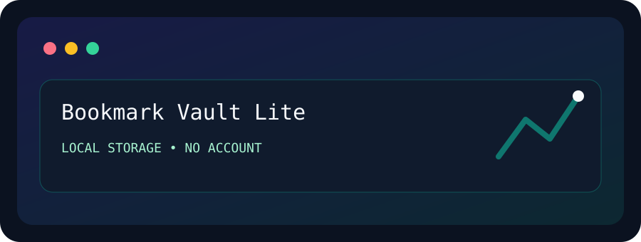

<div align="center">


[](LICENSE)
[](https://www.typescriptlang.org/)
[](https://github.com/CyberLoop-dev/bookmark-vault-lite/stargazers)
[](https://github.com/CyberLoop-dev/bookmark-vault-lite/commits/main)

**A calm, offline-first home for browser bookmarks.**



</div>

## 🧭 Overview

Bookmark Vault Lite imports the standard Netscape bookmark HTML format, stores entries in browser localStorage, and lets you search, tag, add, remove, and export bookmarks without an account or backend.

## ✨ Features

- 🔒 Bookmarks remain in browser localStorage.
- 📥 Import an exported browser bookmark HTML file.
- 🔎 Search titles, URLs, and tags instantly.
- 🏷️ Add tags to keep collections organized.
- 📤 Export a portable Netscape bookmark HTML file.

## 🖥️ Demo

Open the app, import a browser bookmark export, then search or tag the saved links. All actions run in the browser; no upload endpoint exists.

## 🚀 Quick Start

```bash
 git clone https://github.com/CyberLoop-dev/bookmark-vault-lite.git
 cd bookmark-vault-lite
 npm install
 npm start
```

## 🧱 Tech Stack

- ⚛️ React 18
- 🟦 TypeScript
- ⚡ Vite
- 💾 Browser localStorage and File APIs

## 🗂️ Folder Structure

```text
bookmark-vault-lite/
├── index.html
├── package.json
├── tsconfig.json
├── vite.config.ts
├── src/main.tsx
├── src/App.tsx
├── src/style.css
├── assets/illustration.svg
└── README.md
```

## 🛣️ Roadmap

- - [x] Netscape HTML import and export
- - [x] Search, tags, add and remove
- - [ ] Optional JSON backup format

## 🤝 Contributing

Keep bookmark data local-only. Add import fixtures and test duplicate URL handling before changing the storage format.

## 📄 License

Released under the [MIT License](LICENSE).

<div align="center">


</div>
